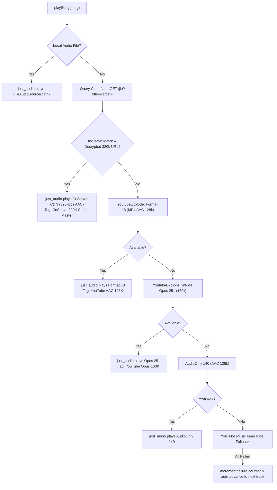

# DILSE MUSIC: PLAY STORE EDITION (AAB) — ARCHITECTURAL BLUEPRINT & MASTER INGESTION VAULT

---

## EXECUTIVE SUMMARY & MISSION BRIEF

DilSe Music is transitioning from an APK-sideloaded/PWA hybrid application to a **Google Play Store production application** distributed via **Android App Bundle (`.aab`)**.

```text
┌──────────────────────────────────────────────────────────────────────────────────────┐
│                                 DILSE PLAY STORE PIVOT                               │
├──────────────────────────────────────────────────────────────────────────────────────┤
│  OLD PARADIGM:                               NEW PLAY STORE PARADIGM:                │
│  • Direct GitHub .apk release downloads      • Google Play App Bundle (.aab)         │
│  • REQUEST_INSTALL_PACKAGES OTA updater      • Play In-App Updates API               │
│  • com.example.music_app debug namespace     • Production app ID (com.charant.dilse) │
│  • Generic presentation widgets              • Fresh, tactile, playful, modular UI   │
│  ──────────────────────────────────────────────────────────────────────────────────  │
│  PRESERVED ARCHITECTURAL FOUNDATION (IMMUTABLE):                                     │
│  • Cloudflare Edge Worker API (dilse-edge-stream.workers.dev)                        │
│  • JioSaavn 320kbps direct CDN streaming & YouTube Explode residential cascade       │
│  • Dual-deck audio engine (_playerA / _playerB) with equal-power crossfading         │
│  • Zero server-side audio bandwidth costs & Zero cloud telemetry                     │
│  • Canonical deduplication & On-device Taste Matrix scoring                          │
└──────────────────────────────────────────────────────────────────────────────────────┘
```

The repository has been synced and verified at upstream commit `a6a54fa` (**466/466 tests passing, 0 analyzer issues**). Below is the comprehensive knowledge extraction, Play Store compliance audit, new skeletal UI architecture, and the master ingestion prompt for the new repository.

---

# PART 1: COMPLETE ARCHITECTURAL KNOWLEDGE VAULT

This section captures every workflow, algorithm, schema, and invariant of DilSe Music so any new IDE or agent can ingest its exact mechanics.

### 1. The 4-Zone Architectural Separation

```text
┌────────────────────────────────────────────────────────────────────┐
│ ZONE A — PRESENTATION (100% REWRITABLE FOR PLAY STORE)             │
│ Flutter widgets, screens, layouts, gestures, animations, sheets,   │
│ cards, dialogs, design tokens, visual feedback, haptics.           │
└───────────────────────────────┬────────────────────────────────────┘
                                │ PUBLIC CONTRACTS ONLY
                                ▼
┌────────────────────────────────────────────────────────────────────┐
│ ZONE B — APPLICATION SERVICES (CONTROLLED EXTENSION)               │
│ MusicService public APIs, PreferencesService, ConnectivityService,  │
│ UpdateService, DynamicArtistService, TasteMatrixScorer.            │
└───────────────────────────────┬────────────────────────────────────┘
                                │
                                ▼
┌────────────────────────────────────────────────────────────────────┐
│ ZONE C — CORE ENGINE (ARCHITECTURALLY IMMUTABLE)                   │
│ MusicService internal decks (_playerA, _playerB), crossfade math,   │
│ stream resolution cascade, queue semantics, offline database.      │
└───────────────────────────────┬────────────────────────────────────┘
                                │
                                ▼
┌────────────────────────────────────────────────────────────────────┐
│ ZONE D — INFRASTRUCTURE (PROTECTED BOUNDARY)                       │
│ Cloudflare Edge Worker (14 endpoints), JioSaavn CDN, YouTube       │
│ InnerTube/Explode, Android AudioService/ExoPlayer foreground driver.│
└────────────────────────────────────────────────────────────────────┘
```

---

### 2. The Ten Absolute Architectural Invariants

1. **Audio Engine Immutability:** Never rewrite `MusicService`, `_playerA`, `_playerB`, active/standby deck swapping, or equal-power crossfade mathematics to suit UI convenience. The UI *consumes* the audio engine; the UI *never becomes* the audio engine.
2. **Cloudflare Edge Immutability:** Cloudflare Worker endpoints (`dilse-edge-stream.workers.dev`), DES-ECB stream decryption, and direct CDN audio routes are protected infrastructure boundaries.
3. **YouTube Engine Immutability:** YouTube fallback cascade (Format 18 $\to$ Opus 251 $\to$ AudioOnly 140 $\to$ InnerTube) runs on-device using residential client IPs. Never proxy audio through custom servers.
4. **Data & Identity Integrity:** `CanonicalSongDedup` is the single source of truth for song identification, title cleaning, artist matching, and language tagging.
5. **Single Source of Truth:** Never duplicate playback, queue, position, library, or playlist state in widgets. Widget state is strictly permitted for presentation concerns (`hoverIndex`, `isExpanded`, `dragOffset`).
6. **No Backdoors:** Widgets must interact exclusively through existing public service abstractions.
7. **Sovereign Bootstrap & Recovery Invariant (Zero-Black-Screen Guarantee):** `main()` must never await unguarded native plugins, audio hardware drivers, or remote networks before calling `runApp()`. If core initialization fails, the app must activate the lightweight, engine-independent `RecoveryShellScreen`.
8. **Release Build & ProGuard Verification Gate:** Whenever platform configurations or dependencies change, a release compilation (`flutter build appbundle --release`) is mandatory before tagging or publishing.
9. **Minimalist Matte & Solid Color Design Standard:** Never use bright neon glow effects, flashy radial/linear gradients, or rainbow accents. All notifications, dynamic island pills, modal sheets, and dialogue surfaces must employ refined static flat/solid palette tones with crisp typography and subtle borders (e.g., solid emerald `#1DB954`, solid ruby `#FA2D48`, solid amber `#F59E0B`, solid crimson `#EF4444`, solid obsidian `#161618`, and clean matte borders `#2E2E32`).
10. **Explicit User Authorization Required for Remote Git Pushes:** When performing tasks, implementing features, fixing bugs, or refactoring, complete the work locally. Never execute `git push` automatically.

---

### 3. Audio Stream Cascade & Deck Engine

When `MusicService.playSong(Video song)` is called, the engine executes a fail-safe multi-tier cascade:



#### Dual-Deck Equal-Power Crossfade Mathematics:
DilSe maintains two separate `AudioPlayer` instances (`_playerA` and `_playerB`). When track position reaches $\text{Duration} - \text{crossfadeSec}$ (configurable 1–12s):
- The inactive player pre-loads and starts buffering the incoming song.
- A 50ms periodic timer calculates volume across the transition duration $T$:
  $$V_{\text{out}}(t) = \cos\left(\frac{\pi}{2} \cdot \frac{t}{T}\right), \quad V_{\text{in}}(t) = \sin\left(\frac{\pi}{2} \cdot \frac{t}{T}\right)$$
  $$\text{Total Acoustic Power} = V_{\text{out}}^2(t) + V_{\text{in}}^2(t) = \cos^2 + \sin^2 \equiv 1.0$$
- This guarantees zero perceived volume dip, zero clipping, and continuous sound.
- An 8-second EOF watchdog ensures variable bitrate (VBR) drift never deadlocks the queue.

---

### 4. Cloudflare Edge Worker API Registry

Base URL: `https://dilse-edge-stream.charanteja-kondakalla030206.workers.dev`

| Endpoint | Method | Parameters | Function & Response |
|---|---|---|---|
| `/health` | `GET` | None | Engine status, KV availability check. |
| `/jio/search` | `GET` | `q`, `limit=20`, `page=1` | Searches JioSaavn catalog; returns decrypted 320k direct stream URLs, 500x500 artwork, and metadata. |
| `/jio/suggestions` | `GET` | `q`, `limit=8` | Instant autocomplete search suggestions (<80ms response). |
| `/jio` | `GET` | `title`, `artist` | Single-track resolver with confidence scoring; used for background stream pre-warming and artwork enrichment. |
| `/jio/recommendations` | `GET` | `q`, `language`, `limit=20` | Dynamic queue replenishment when active queue drops below 5 tracks. |
| `/jio/trending` | `GET` | `lang=hindi`, `limit=30` | Official regional trending songs with clean Romanized metadata. |
| `/jio/charts` | `GET` | `lang=hindi` | Regional top charts playlist. |
| `/jio/featured_albums`| `GET` | `lang=hindi`, `limit=20` | Blockbuster soundtracks and curated albums. |
| `/jio/album` | `GET` | `id` | All tracks from an album with decrypted 320k stream URLs. |
| `/lyrics` | `GET` | `title`, `artist`, `lang`, `duration`, `videoId` | 3-stage lyric pipeline: JioSaavn official $\to$ YTM InnerTube $\to$ LRCLIB (+350 synced score threshold). |
| `/ytm/radio` | `GET` | `v` (videoId), `limit=30` | Google's neural collaborative automix graph based on acoustic compatibility. |
| `/ytm/search` | `GET` | `q`, `limit=20` | Official YouTube Music songs search (CORS bypassed). |
| `/user/sync` | `GET` / `POST`| `userId` (in URL or JSON) | Cloudflare KV persistence for playlists and liked songs. |

---

### 5. On-Device Machine Learning & Recommendation Logic

#### The Taste Matrix Scorer:
Personalized track affinity is scored entirely on-device without cloud profiling:
$$\text{Score}(t) = (\text{position\_weight} \times 0.25) + \text{artist\_affinity} - \text{skip\_penalty} + \text{top\_artist\_bonus} + \text{lang\_match\_bonus} - \text{lang\_mismatch\_penalty} + \text{liked\_bonus}$$
- **Artist Fatigue Rule:** Enforces a hard cap of maximum 2 tracks per artist in any sliding window of 4 consecutive tracks.
- **Skip Penalty:** Tracks skipped within 20 seconds receive an on-device score deduction to avoid recurring unliked tracks.

#### Multi-Tier Deduplication Engine:
- Strips junk tags: `(Official Video)`, `(Lyrical)`, `(From "Movie")`, `Remix`, `4K`, `Full Song`, `Lo-Fi`, `Karaoke`.
- Normalizes Romanized Indic titles (Telugu, Hindi, Tamil, Kannada, Malayalam, Punjabi, Bengali).
- Levenshtein distance matching threshold ($\ge 0.82$) combined with artist compatibility scoring.

---

### 6. Audiophile Hardware DSP & Headroom Control

In Android native OpenSL/AudioFX hardware equalizers, sound is protected by **Audiophile Anti-Clipping Headroom Compensation**:
- In digital audio, boosting equalizer bands (+5 dB to +12 dB) causes digital clipping against the 0 dBFS ceiling, creating harsh harmonic distortion.
- Anti-clipping headroom calculations:
  $$\text{Safe Ceiling} = +1.5\text{ dB}$$
  $$\text{Headroom Cut} = \max(0, \max(\text{Gains}) - 1.5\text{ dB})$$
  $$\text{Compensated Gain}_i = \text{Raw Gain}_i - \text{Headroom Cut}$$
- Preserves the exact tonal curve and punchy bass while guaranteeing 0% digital clipping distortion.

---

# PART 2: GOOGLE PLAY STORE (AAB) COMPLIANCE AUDIT

To publish DilSe Music on the Google Play Store via Gradle App Bundle (`.aab`), specific changes from the existing GitHub APK setup are mandatory:

### 1. Permissions & Policies to Remove/Modify

| Permission / Component in `AndroidManifest.xml` | Play Store Status | Action Required |
|---|---|---|
| `<uses-permission android:name="android.permission.REQUEST_INSTALL_PACKAGES" />` | **STRICTLY PROHIBITED** | **Remove completely.** Google Play rejects any app that requests raw APK install permissions unless it is an alternative app store. |
| `sk.fourq.otaupdate.OtaUpdateFileProvider` & `InstallResultReceiver` | **VIOLATION** | **Remove.** GitHub APK self-updating violates Google Play Device and Network Abuse policies. |
| `android.permission.FOREGROUND_SERVICE_MEDIA_PLAYBACK` | **MANDATORY** | **Keep / Add.** Required on Android 14+ (API 34+) for continuous background music playback. |
| `android:usesCleartextTraffic="true"` | **RESTRICTED** | **Disable or restrict via Network Security Config.** Play Store requires HTTPS for all external traffic. Cloudflare and JioSaavn CDNs are fully HTTPS. |

### 2. Gradle & App Bundle Configuration

1. **Production Application ID:**  
   Namespace and `applicationId` in `android/app/build.gradle.kts`:
   ```kotlin
   applicationId = "com.charant.dilse"
   ```

2. **Target SDK & Java Version:**
   - `compileSdk = 35`
   - `targetSdk = 35` (Google Play requires Target SDK 34 or higher)
   - `minSdk = 24` (Android 7.0+)
   - Java 17 toolchain with Core Library Desugaring enabled.

3. **Release Signing Configuration:**
   Configure `key.properties` for Google Play App Signing:
   ```kotlin
   signingConfigs {
       create("release") {
           storeFile = file(project.property("MYAPP_UPLOAD_STORE_FILE") ?: "upload-keystore.jks")
           storePassword = project.property("MYAPP_UPLOAD_STORE_PASSWORD") ?: ""
           keyAlias = project.property("MYAPP_UPLOAD_KEY_ALIAS") ?: ""
           keyPassword = project.property("MYAPP_UPLOAD_KEY_PASSWORD") ?: ""
       }
   }
   ```

4. **App Bundle Build Command:**
   ```bash
   flutter build appbundle --release
   # Output: build/app/outputs/bundle/release/app-release.aab
   ```

5. **In-App Updates (Play Store Native):**
   Replace the GitHub OTA downloader with the official Google Play In-App Updates SDK (`package:in_app_update`), providing seamless immediate or flexible background updates directly through the Play Store.

---

# PART 3: NEW SKELETAL UI ARCHITECTURE & TACTILE WIDGET CONCEPTS

For the brand-new Play Store version, the UI is decoupled from the backend. The UI only talks to `MusicService` and public services. Below are the structural skeletal templates for new, fun, tactile widgets.

```text
lib/
├── core/                         <-- Immutable Core Engine (Zone C & D)
│   ├── audio/                    (Dual-deck engine, crossfade, ExoPlayer IPC)
│   ├── edge/                     (Cloudflare client, JioSaavn decryptor, InnerTube)
│   └── models/                   (Video, JioAlbum, ActiveStreamInfo, TasteMatrix)
│
├── services/                     <-- Application Services Layer (Zone B)
│   ├── music_service.dart
│   ├── preferences_service.dart
│   ├── connectivity_service.dart
│   └── audio_effects_service.dart
│
├── presentation/                 <-- Brand-New UI/UX Layer (Zone A)
│   ├── navigation/               (Fluid bottom pill, gestures, page routing)
│   ├── theme/                    (Matte obsidian palette, solid emerald/ruby tokens)
│   ├── screens/
│   │   ├── now_playing/          (Interactive player, canvas visualizer, vinyl mode)
│   │   ├── discovery/            (Dynamic hero flow, smart mixes, carousel cards)
│   │   ├── search_radar/         (Live search with voice & visual category tiles)
│   │   ├── library_vault/        (Playlists, offline downloads, favorite tracks)
│   │   └── audiophile_lab/       (Visual equalizer, 3D spatializer, headroom meter)
│   │
│   └── widgets/
│       ├── dynamic_island_player.dart  (Compact floating dock with audio wave)
│       ├── tactile_glass_card.dart     (3D micro-depth card with haptic clicks)
│       ├── interactive_karaoke.dart    (Synced lyrics with line scrub & dual mode)
│       ├── swipeable_queue_tile.dart   (Swipe-to-queue / swipe-to-remove gestures)
│       └── sleep_timer_dial.dart       (Tactile radial dial with gradual fadeout)
```
